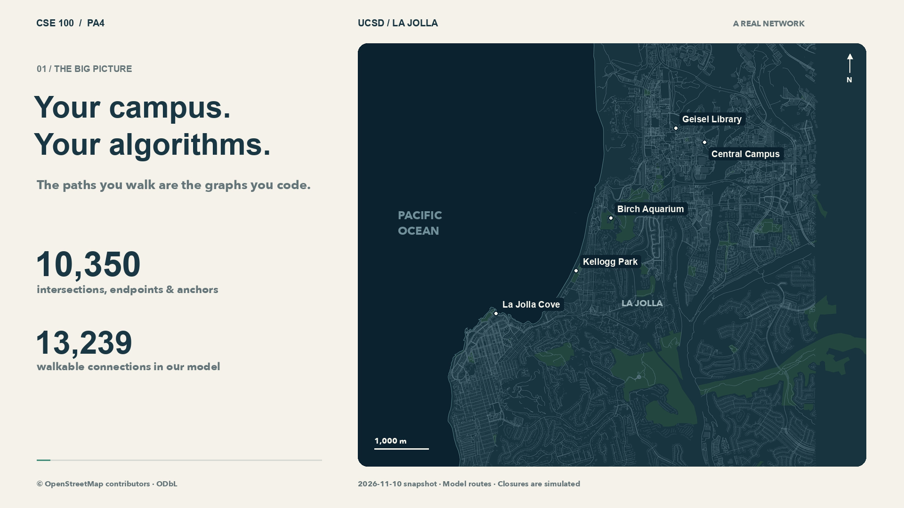

# CSE 100 — PA4: Your Campus, Your Algorithms



Implement **DFS, BFS, Dijkstra, and disjoint-set union** on a real walking graph around UC San Diego and La Jolla.

- **[Read the full assignment](PA4-Graphs.md)** — functions, contracts, examples, build/run, testing, and submission.
- [Watch the dataset walkthrough](media/campus-algorithms.mp4) — download the MP4 to play locally.
- [Dataset guide](data/walk/README.md) · [Data attribution](data/walk/ATTRIBUTION.md)

Two frozen datasets are included: the 10,350-node campus graph and a [266,647-node San Diego graph](data/san-diego/README.md). **Visualization is not part of the assignment**; the video is an optional introduction. File parsing, graph storage, and the closure/restoration driver are provided. Implement the TODOs in `src/Graph.cpp` and `src/DisjointSet.*`, and write your testers in `test/`.

## Quick start

Use the [installation instructions](PA4-Graphs.md#build-and-run) first, then:

```bash
meson setup build
meson compile -C build -j 1
meson test -C build --print-errorlogs
```

**The starter compiles, but its example tests intentionally fail until you implement the TODOs.** The tests are examples, not a complete correctness suite.

Checkpoint: **December 1, 2026, 11:59 PM Pacific** (DFS + BFS).

Final: **December 6, 2026, 11:59 PM Pacific** (all algorithms).

Submit implementations **and testers**, packaged with `python3 make_submission.py`, on Gradescope. Keep solutions private.
